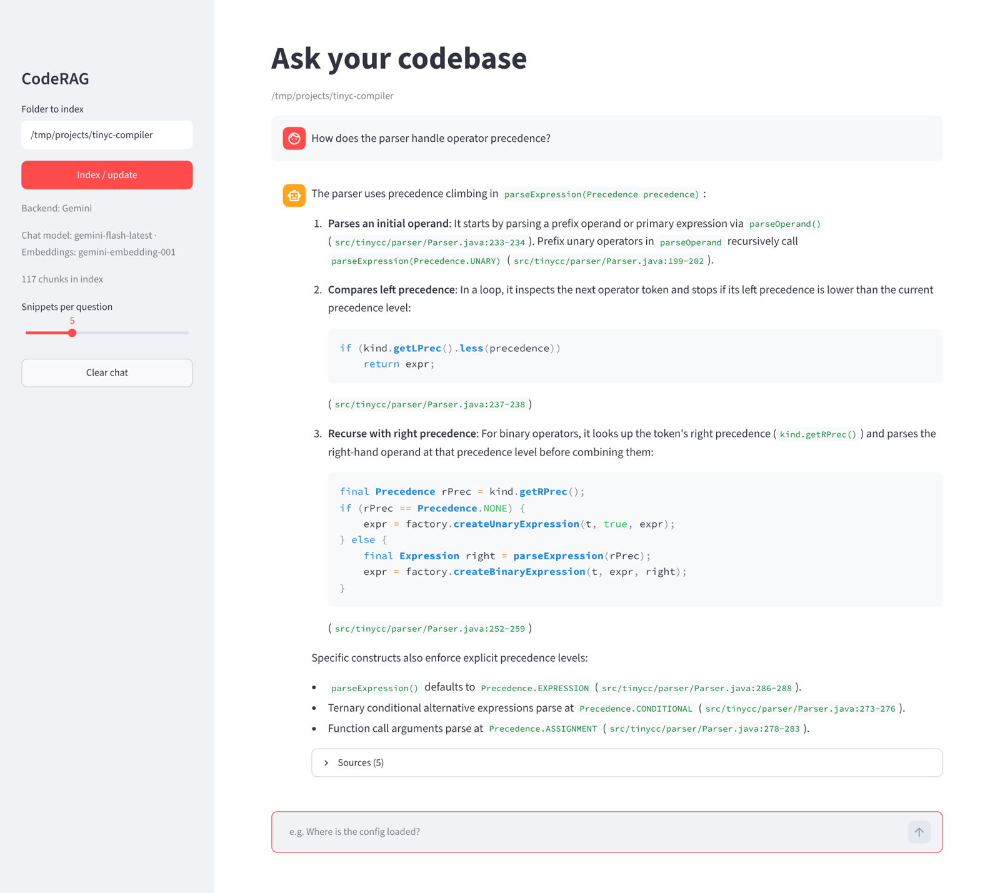

# CodeRAG

[](https://github.com/yuvrajsingh1015/Codebase-Rag-Chat/actions/workflows/ci.yml)

Ask questions about a local codebase in plain language. CodeRAG splits your source files into chunks, embeds them into a FAISS vector index and answers questions with a chat model that only sees the most relevant snippets. Every answer cites the files and line ranges it used.

Runs fully local with [Ollama](https://ollama.com) by default, or with Gemini (free API key) or the OpenAI API by changing two settings.



## How it works

```
 source files ──► line chunks (60 lines, 10 overlap) ──► embeddings ──► FAISS index (cosine)
                                                                              │
 question ──► query embedding ──► top-k search ───────────────────────────────┘
                                        │
                                        ▼
                     prompt with cited snippets ──► chat model ──► streamed answer + sources
```

- **Chunking by lines** keeps line numbers, so answers can point to `path:start-end`. Each chunk is embedded together with its file path, because names like `auth/login.py` carry a lot of meaning.
- **Incremental re-indexing.** Files are hashed (SHA-1). On re-index, unchanged files keep their stored vectors and only new or edited files are sent to the embedding model. Deleted files are dropped.
- **Cosine similarity** via normalized vectors and `faiss.IndexFlatIP`.
- **Per-folder cache.** Each indexed folder gets its own index under `~/.cache/coderag/`, so nothing is written into your project.
- **Retries** for rate limits (HTTP 429, waiting as long as the API asks), overloaded models (5xx) and network errors. A wrong key or model name fails right away with a readable message instead.
- **Batching**: 32 inputs per embedding request.

## Setup

Requires Python 3.10+.

```bash
git clone https://github.com/yuvrajsingh1015/Codebase-Rag-Chat.git
cd Codebase-Rag-Chat
python -m venv .venv && source .venv/bin/activate
pip install -e ".[dev]"
cp .env.example .env
```

**Local (default):** install Ollama and pull a chat and an embedding model:

```bash
ollama pull gemma3
ollama pull nomic-embed-text
```

**Gemini (free):** create an API key at [aistudio.google.com/apikey](https://aistudio.google.com/apikey), then set in `.env`:

```bash
AI_BACKEND=gemini
API_KEY=your-key
```

Models default to `gemini-flash-lite-latest` and `gemini-embedding-001`, which have the most generous free limits. The free tier allows about 100 embeddings per minute and a few chat requests per minute. When a per-minute limit is hit, CodeRAG waits as long as the API asks and carries on, so a first index of a bigger repo can take a minute or two. For more careful answers set `CHAT_MODEL=gemini-3.5-flash`, which has a smaller daily free quota.

**OpenAI:** set these in `.env`:

```bash
AI_BACKEND=remote
API_KEY=sk-...
```

Models default to `gpt-4o-mini` and `text-embedding-3-small`.

## Usage

**Web UI**

```bash
streamlit run app.py
```

Enter a folder in the sidebar, click **Index / update**, then ask away. Each answer has a "Sources" section with the matched snippets and their similarity scores.

**Command line**

```bash
coderag index ~/projects/some-repo
coderag ask "Where is the database connection opened?" --path ~/projects/some-repo --sources
coderag chat --path ~/projects/some-repo
```

## Configuration

All settings are read from `.env` (see [.env.example](.env.example)).

| Variable | Default | Meaning |
|---|---|---|
| `AI_BACKEND` | `local` | `local`/`ollama`, `gemini` or `remote`/`openai` |
| `BASE_URL` | backend default | Override the endpoint, e.g. for LM Studio |
| `API_KEY` | | Needed for `gemini` and `remote` |
| `CHAT_MODEL` | per backend | Model that writes the answer |
| `EMBEDDING_MODEL` | per backend | Model that embeds code and questions |
| `WATCHED_DIR` | `.` | Default folder to index |
| `TOP_K` | `5` | Snippets sent to the chat model |
| `CHUNK_LINES` / `CHUNK_OVERLAP` | `60` / `10` | Chunk size in lines |
| `CODERAG_CACHE_DIR` | `~/.cache/coderag` | Where indexes are stored |

Indexed file types and skipped folders (`.git`, `node_modules`, `venv`, `build`, other hidden folders except `.github`, ...) are set in [coderag/config.py](coderag/config.py).

## Project structure

```
coderag/
  config.py       settings from .env
  ai_client.py    OpenAI-compatible client for Ollama, Gemini or OpenAI
  embeddings.py   batched embedding calls, normalization
  retry.py        retry rules and readable API errors
  index.py        file walking, chunking, FAISS index, incremental rebuild, save/load
  search.py       query embedding + top-k search
prompt_flow.py    prompt building and streamed answers
app.py            Streamlit UI
main.py           CLI (index / ask / chat)
tests/            pytest suite, uses a fake embedder so no API or model is needed
```

## Tests

```bash
pytest
ruff check . && ruff format --check .
```

The tests use a small hashed bag-of-words embedder instead of a real model, so they run offline in CI and check chunking, incremental re-indexing, save/load, ranking and prompt building.

## Ideas for later

- Chunk by function and class using a parser (e.g. tree-sitter) instead of fixed line windows
- Hybrid search: combine vector search with keyword (BM25) scores
- Watch the folder and re-index automatically on save

## License

MIT. Inspired by [Neverdecel/CodeRAG](https://github.com/Neverdecel/CodeRAG).
